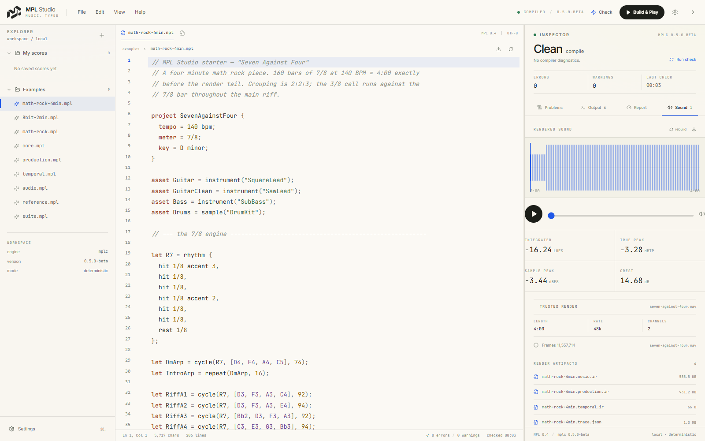

# MPL Studio

A light-first, local-first editor for MPL (Music Production Language) — browser
and native desktop.

Built with React 19, Vite, Tailwind CSS, CodeMirror 6 and Tauri 2. The browser
build talks to the real compiler through a local Express bridge; the desktop app
invokes the compiler directly from Rust. No model calls, no cloud.

The default theme is warm paper, with a dark theme and system-follow mode in
Settings. The ribbon-note mark is used in the app, title bar and installer icon.



## Starter examples

`examples/math-rock-4min.mpl` — **Seven Against Four**, 160 bars of 7/8 at 140
BPM (4:00), with a 2+2+3 grouping and independent guitar/bass/drum cells.

`examples/8bit-2min.mpl` — **Neon Cartridge**, 75 bars of 4/4 at 150 BPM (2:00),
built from pulse-lead arpeggios, octave bass and noise drums.

Both are loaded by the editor like the other examples; the math-rock piece is
selected on first launch.

## Run

The bridge expects a built `mplc` at `build/Release/mplc.exe` or
`build/Debug/mplc.exe`. Build it first:

```powershell
cmake --build build --config Release --target mplc
```

Then:

```powershell
cd web
pnpm install
pnpm dev
```

Open **http://127.0.0.1:5178**.

`pnpm dev` starts both the compiler bridge (`127.0.0.1:4317`) and Vite
(`127.0.0.1:5178`). For production:

```powershell
pnpm build
pnpm start
```

and open **http://127.0.0.1:4317**.

## Desktop app (Tauri 2)

The native app bundles `mplc.exe`, the standard library and examples. It does not
need Node or the Express bridge at runtime.

```powershell
# from web/
powershell -NoProfile -ExecutionPolicy Bypass -File scripts/package-windows.ps1
```

The script builds the frontend, prepares resources, compiles the Tauri app, and
creates a local NSIS installer plus a portable zip:

```text
web/dist-tauri/MPL-Studio_0.1.0_x64-setup.exe
web/dist-tauri/MPL-Studio_0.1.0_x64-portable.zip
web/dist-tauri/SHA256SUMS.txt
```

For a development shell:

```powershell
pnpm tauri dev
```

Tauri's own `--bundles nsis` downloader is not used here because it fetches the
NSIS toolchain from GitHub at build time; the packaging script uses the locally
installed NSIS (`winget install NSIS.NSIS`) instead. The app itself is still
built by Tauri 2 (unsigned in this local build).

## Features

- Light-first editorial UI, with dark and system-follow themes.
- Collapsible file tree: My scores, Examples, workspace/compiler summary.
- Menu bar: File, Edit, View, Help.
- Settings dialog: theme, editor font size, soft wrap, automatic checks, motion,
  shortcuts; preferences persist in local storage.
- Custom MPL syntax highlighting and completion (CodeMirror 6).
- Live compiler diagnostics with click-to-line and gutter markers.
- File tabs, example browser, upload/download, unsaved indicators.
- Long-form starter arrangements: 4:00 math rock and 2:00 8-bit.
- Build & Play: real `mplc build`, WAV playback, decoded waveform, loudness
  metrics from `mplc analyze`.
- Inspector: Problems, compiler output/artifacts, report counts/modules, sound.
- Keyboard: `Ctrl/Cmd + Enter` check, `Ctrl/Cmd + Shift + Enter` build,
  `Ctrl/Cmd + S` download current source, `Ctrl/Cmd + N` new score,
  `Ctrl/Cmd + ,` settings.
- Resizable inspector and responsive light UI.

## Layout

```text
web/
  server/index.mjs             local compiler bridge + static production server
  src-tauri/                   Tauri 2 app, Rust compiler bridge, NSIS installer
  public/brand/                ribbon logo, favicon source, icon source
  src/app/
    App.tsx                    workspace shell, commands, shortcuts
    Settings.tsx               persisted theme/editor preferences
  src/components/
    editor/CodeEditor.tsx      CodeMirror 6, MPL language, diagnostics
    audio/Waveform.tsx         decoded WAV waveform and transport
    layout/MenuBar.tsx         application menu
  src/features/
    file-tree/FileTree.tsx     explorer tree
    inspector/Inspector.tsx    problems/output/report/sound
    settings/                  settings + about dialogs
  src/lib/api.ts               bridge/Tauri client
  src/lib/mplLanguage.ts       custom MPL tokenizer
  src/styles/index.css         light/dark token system and layout primitives
  src/types/index.ts           shared source/build/diagnostic types
  scripts/                     Playwright smoke checks, Tauri packaging
```

## Bridge API

| Method | Path | Purpose |
| --- | --- | --- |
| GET | `/api/health` | compiler path/version |
| GET | `/api/examples` | examples with source |
| POST | `/api/check` | compile check, JSON diagnostics |
| POST | `/api/report` | compiler report JSON |
| POST | `/api/build` | build, WAV, analysis, artifacts |
| GET | `/api/audio/:id/:file` | rendered WAV |

All generated files live under `web/.runtime/` and are local only.

## Known limits

- Tabs are in-memory; there is no project filesystem editor yet.
- The bridge compiles a temporary copy, so examples with relative file imports
  outside `std/` are not supported yet.
- No language server / semantic rename yet; the editor uses the compiler CLI.
- Build requests are serialized per user action; no server-side queue.
- Tauri audio is transferred to the WebView as base64; very long renders may
  need a streaming/asset-protocol path later.
- The two long starter examples take longer to build than the short reference
  examples; the 4:00 math-rock render is about 92 MB at 48 kHz/float32 stereo.
